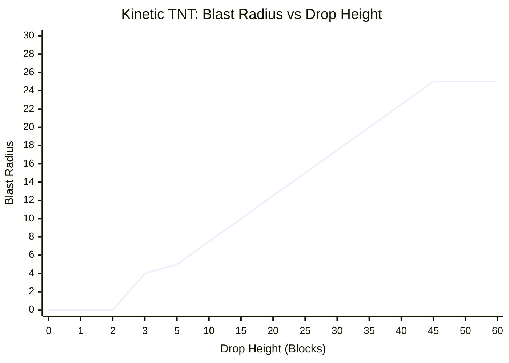

# 💥 Kinetic TNT — Physics & Ballistics Guide

Forget flint and steel. Forget redstone repeaters. 

**Kinetic TNT** is a gravity-bound explosive that converts gravitational potential energy and blast shockwaves into raw destructive force. It lands like sand, flies like an artillery shell, and scales its blast radius based on how hard it impacts the ground.

---

## 🎯 How It Works: The Rules of Engagement

* **Ground Placement (0–2 Blocks):** **Completely Safe.** You can build with it, stack it, or walk on it. If it falls only 1 or 2 blocks, it lands silently without detonating.
* **The 3-Block Threshold:** Drop it from 3 blocks or higher, and the impact shock triggers an immediate detonation.
* **Terminal Velocity Scaling:** The higher it drops, the larger the blast radius. 
* **Shockwave Chain Reactions:** Catching a nearby Kinetic TNT in an explosion doesn't destroy it—it **propels it through the sky as an aerodynamic artillery mortar**. When it crashes back down, it detonates!

---

## 📐 The Math & Physics

### 1. The Blast Radius Formula (Vertical Drop)

A standard Minecraft TNT block has a fixed explosion power of **4.0** (roughly a 4-to-5 block crater radius). 

Kinetic TNT starts at base TNT power (**4.0**) the moment it drops **3 blocks**, and scales continuously with every additional block fallen:

$$\text{Blast Radius} = 4.0 + \Big((\Delta Y - 3) \times 0.5\Big)$$

*Where $\Delta Y$ is the vertical drop distance in blocks.*

#### Impact Power Scale:
| Drop Height ($\Delta Y$) | Total Blast Radius | Equivalent Destructive Power |
| :--- | :--- | :--- |
| **0 – 2 Blocks** | **0.0** | None (Safe landing) |
| **3 Blocks** | **4.0** | 1x Standard TNT |
| **10 Blocks** | **7.5** | Nearly 2x Standard TNT |
| **20 Blocks** | **12.5** | Massive crater (Wither spawn blast size) |
| **45+ Blocks** | **25.0 (Capped)** | Tactical Nuclear Crater (Leveling entire biomes) |

*(Note: Maximum radius is hard-capped at **25.0** to prevent crashing your game or freezing the server!)*

---

### 2. Ballistic Shockwave Propulsion (Chain Reactions)

When a Kinetic TNT detonates, it generates an expanding spherical pressure wave. Any neighboring Kinetic TNT blocks calculate their trajectory away from the blast epicenter:

$$\vec{D} = \text{Target Pos} - \text{Blast Epicenter}$$

$$\hat{u} = \frac{\vec{D}}{\|\vec{D}\|} \quad \text{(Unit Direction Vector)}$$

#### Blast Impulse (Speed):
The shockwave follows the **Inverse-Distance Law**—the closer the block is to the initial bomb, the harder it gets thrown (with a minimum launch floor of 0.8):

$$\text{Launch Speed} = \max\left(0.8,\ \frac{2.5}{\text{Distance} + 0.5}\right)$$

To give it a natural ballistic mortar arc across the sky, an upward lift coefficient ($+0.4$ to $+1.2$) is automatically injected into the vertical velocity:

$$\vec{V} = \Big(\hat{u}_x \times \text{Speed},\ \ \hat{u}_y \times \text{Speed} + \text{Lift},\ \ \hat{u}_z \times \text{Speed}\Big)$$

---

### 3. Combined Projectile Kinetic Energy

When a launched TNT crashes into a distant mountain or plains biome, its destructive power doesn't just measure vertical fall—it calculates **total kinetic momentum**, factoring in the horizontal distance it flew across the map:

$$\text{Total Kinetic Power} = \Delta Y + (0.6 \times D_{\text{horizontal}})$$

* **$\Delta Y$:** Vertical drop from its flight apex.
* **$D_{\text{horizontal}}$:** Euclidean distance traveled across the $X/Z$ plane ($\sqrt{\Delta X^2 + \Delta Z^2}$).

If this combined kinetic value reaches **3.0 or higher**, the missile detonates on impact, kicking off rolling carpet-bomb chain reactions!

---

## 🎮 Combat Strategies

1. **Orbital Kinetic Strike:** Build a cobblestone platform at world build limit ($Y = 319$), look down, and place a block. It will reach maximum terminal blast cap before vaporizing whatever was underneath.
2. **Mortar Artillery Batteries:** Place a line of Kinetic TNT on the ground with 1 block of air between each. Drop a stone or single TNT onto the first one to launch a spreading barrage across enemy bases.
3. **Trapdoors & Trap Pits:** Rig trapdoors over a 4-block deep pit. When players step on the pressure plate, they drop with the TNT—guaranteeing point-blank detonation on the floor.